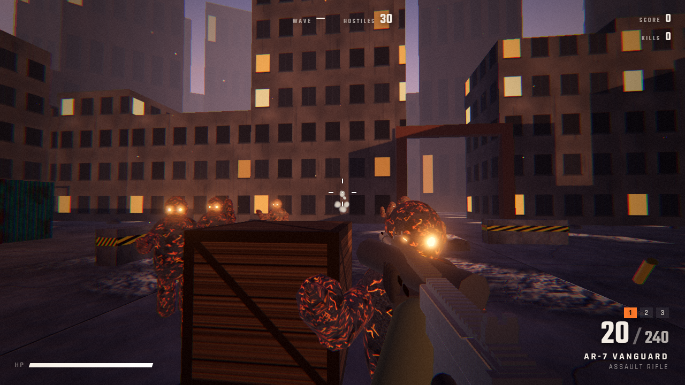

# HORDEFALL

A horde shooter that runs in the browser, built from scratch on three.js and WebGL shaders. There are no model, texture or sound files: the guns, arena, enemies, textures and audio are all generated in code.

**Play:** https://hordefall-zeta.vercel.app



## Controls
| | |
|---|---|
| WASD | move |
| Shift | sprint |
| C / Ctrl | crouch (slide while sprinting) |
| Space | jump |
| Left mouse | fire |
| Right mouse | aim down sights |
| R | reload |
| 1 / 2 / 3, mouse wheel | switch weapon |
| Esc | pause |

## Weapons
- **AR-7 Vanguard**: full-auto assault rifle with iron sights and a learnable recoil pattern.
- **KS-12 Breacher**: pump shotgun with 10 pellets, shell-by-shell reload you can interrupt by firing, and iron sights.
- **MR-30 Longbow**: semi-auto marksman rifle that pierces one target. It has a collimated red-dot sight drawn by a shader, so the dot appears only through the glass.

## Tech
- Viewmodel rendered in its own scene. Spring-damper kick, sway, inertia and bob; heavier guns move slower.
- Two recoil layers: aim recoil that recovers over time, and a separate visual camera kick.
- Hitscan with head, body and limb zones, damage falloff, hit, headshot and kill markers, damage numbers, and hitstop on kills.
- Enemies are 15-joint skeletons drawn with instanced meshes. They run a procedural gait, flinch and stagger when hit, and turn into Verlet ragdolls with a dissolve shader on death.
- Horde AI: a flow field over a navigation heightmap, flanking, separation steering, and leaps onto high ground.
- Post chain: GTAO (high quality only), bloom, ACES tone mapping, color grade, vignette, damage vignette.
- Audio is layered WebAudio synthesis with a convolution reverb tail.

```
npm install
npm run dev
```
